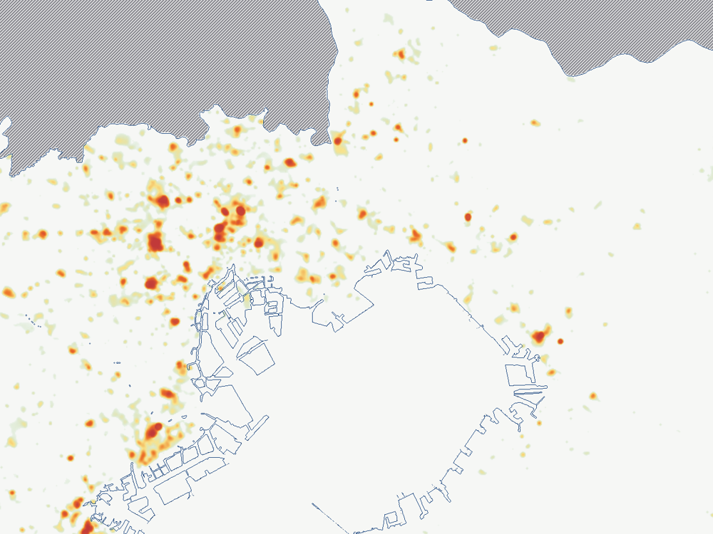

# 숙박 안심도 지도 (Anshin Map)

일본 도쿄(섬 제외)·가나가와·지바에서 숙소를 고를 때, 주변 치안 분위기를 한눈에 보는 지도입니다.
유흥·도박·성인 시설의 밀집도와 경찰이 공개한 거리 범죄 통계를 100m 격자 점수(0~100)로 만들어,
구글맵과 같은 줌 단계의 지도 위에 히트맵으로 겹쳐 보여 줍니다.

**지도 보기:** https://yasen-siyo.github.io/anshin-map/



## 무엇을 볼 수 있나요

- 점수: 100에 가까울수록 안심, 0에 가까울수록 주의. PC 는 마우스를 올리면, 폰은 탭하면 그 위치 점수가 나옵니다.
- 히트맵: 초록(안심) → 노랑 → 빨강(주의). 투명도 슬라이더로 배경 지도와 겹쳐 보기.
- 검색: 한국어·영어·일본어 지명(예: 신주쿠, Shinjuku, 新宿駅) 또는 구글맵에서 복사한 좌표.
- "구글맵에서 같은 위치 열기" 버튼: 같은 중심·줌의 구글맵을 새 창으로 엽니다. 예약 사이트 지도와 나란히 비교할 때 편해요.
- 줌 14 이상에서 시설 위치 점 표시 (종류별 켜고 끄기).
- 파란 경계선은 데이터가 있는 범위, 회색 빗금은 데이터가 없는 이웃 현입니다.
- 배경 지도: 영어 도로 지도(Esri, 기본), 영어 연회색, 일본어(국토지리원), OpenStreetMap.

## 점수는 이렇게 만들어요

| 요소 | 내용 |
|---|---|
| 시설 | 스트립클럽·성매매 업소·나이트클럽·파칭코·도박·성인용품점·러브호텔·바를 가중치를 두고 반경 약 150m로 퍼뜨려 합산 |
| 범죄 | 세 현이 공통으로 町丁(동네) 단위로 공개하는 거리 범죄 6종의 연간 건수 ÷ 면적 |
| 합산 | 위험 = 0.7 × max(시설, 범죄) + 0.3 × (시설 55% + 범죄 45%), 안심도 = 100 − 위험 × 100 |

이자카야와 편의점은 위험 요소로 치지 않습니다. 자세한 기준과 검증 결과는 [docs/METHODOLOGY.md](docs/METHODOLOGY.md), 데이터 출처와 라이선스는 [docs/DATA_SOURCES.md](docs/DATA_SOURCES.md)에 있습니다.

> 이 점수는 유흥시설 밀집도와 신고된 거리 범죄만 반영한 참고 지표입니다. 실제 안전을 보장하지 않으며,
> 호텔 자체의 상태, 밤길 밝기, 인파 등은 반영되지 않습니다.

## 저장소 구성

```
index.html            완성된 지도 (GitHub Pages 시작 페이지, 데이터가 모두 들어 있는 단일 파일)
web/
  template.html       지도 페이지 틀 (build_page.py 가 데이터를 넣어 index.html 생성)
  heatmap.png         히트맵 이미지 (Web Mercator 정렬)
  anshin.png          점수표 (R = 안심도, G = 데이터 범위 코드)
  coverage.png        데이터 범위 경계선·빗금
  poi.geojson         시설 위치
  meta.json           이미지 범위·격자·집계 정보
scripts/
  fetch_data.sh       경찰 통계·e-Stat 경계 내려받기
  fetch_osm.py        OpenStreetMap 시설 내려받기 (Overpass, 칸별 재시도)
  prep_crime.py       세 현 범죄 자료를 한 형식으로 정리
  score.py            100m 격자 점수 계산 → web/*.png, meta.json, poi.geojson
  build_page.py       web/ 결과를 template.html 에 넣어 index.html 생성
  check.py            알려진 지역 점수 확인
  config.py           대상 범위·가중치·기준값 (점수 조정은 여기서)
  geo.py              shapefile 읽기·이름 정규화·가우시안 흐림 (외부 GIS 라이브러리 없이)
data/raw/             내려받은 원자료 (용량이 커서 저장소에는 넣지 않음)
docs/                 방법론, 데이터 출처, 배포 안내
```

## 직접 다시 만들기

Python 3.10 이상과 `numpy`, `pillow` 가 필요합니다.

```bash
pip install -r requirements.txt
bash scripts/fetch_data.sh        # 경찰 통계·경계 (약 120MB)
python3 scripts/fetch_osm.py      # OSM 시설 (Overpass 서버 상태에 따라 오래 걸릴 수 있음)
python3 scripts/prep_crime.py
python3 scripts/score.py
python3 scripts/build_page.py     # → index.html
python3 scripts/check.py
```

가중치나 기준값은 `scripts/config.py` 에서 바꾼 뒤 `score.py` → `build_page.py` 만 다시 실행하면 됩니다.

## GitHub Pages 에 올리기

[docs/DEPLOY.md](docs/DEPLOY.md) 를 참고하세요. 요약하면 저장소에 올린 뒤
Settings → Pages → Branch 를 `main` / `(root)` 로 지정하면 됩니다.

## 라이선스

코드는 [MIT License](LICENSE) 입니다. 지도에 들어간 데이터는 각 출처의 이용 조건을 따릅니다
(OpenStreetMap 은 ODbL, 경찰·e-Stat 자료는 각 기관의 이용 규약). [DATA_LICENSE.md](DATA_LICENSE.md) 참고.
